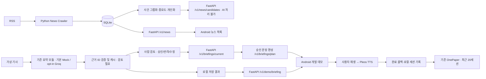

# DriveBrief AI

## 현재 기본 기능: 실제 RSS 자동 브리핑

일반 앱 홈에서 관심 분야와 기사 설명량을 선택하고 ‘브리핑 시작’을 누르면, 익명 세션으로 Supabase 게시 RSS 브리핑을 읽어 Pleos TTS로 재생합니다. 로컬 JSON이나 debug 플래그가 필요하지 않습니다.

- 기존 그룹화·중요도·균형 선택으로 최대 25건을 한 번 선정합니다. 세 옵션은 동일 기사·동일 순서입니다.
- 짧게는 기사당 제목 1구간, 중간은 최대 3구간, 길게는 최대 5구간입니다. RSS에 정보가 부족하면 분량을 만들지 않습니다.
- RSS 제목·설명 그대로의 추출이며 AI 요약이 아닙니다. 기사별 승인 없이 `rss_auto_validated`로 구분합니다.
- 기존 수집 동기화 성공 후 변경된 입력만 재선정·게시합니다. 새 스케줄러는 설치하지 않습니다.
- 기어·오디오 포커스·청취 기록·OnePaper·QR 흐름을 유지합니다.
- 기사 전문 기반 AI 요약의 권한·검토 절차와 기존 비공개 미리보기는 별도로 유지합니다.
- 출처별 재사용 조건은 아직 확인되지 않았습니다. 익명 사용자 조회 및 QR 링크를 통한 노출 범위는 별도 관리해야 합니다.

실행·스키마·검증·운영 한계는 [RSS_AUTO.md](backend/RSS_AUTO.md)를 참고하세요.
[RSS_PREVIEW.md](backend/RSS_PREVIEW.md)와 아래 문서는 이전 단계의 개발 기록입니다.

## 공유 DB 통합 브랜치

최신 main의 AI 선정·편성·품질 검사·청취 기록과 신문 디자인 브랜치를 병합하고, RSS/Supabase 연동을 연결했습니다.

- 뉴스: 기존 수집 → Supabase, 앱은 로그인 후 공유 뉴스 조회. 최근 5일·최대 1만 건, 변경분만 전송.
- 선정: 기존 `/v1/news/candidates`가 공유 뉴스 저장소를 읽습니다. 계산 기준을 유지하며 반복 토큰 계산을 캐시합니다.
- 승인 요약: 기존 `ReviewStore`/`RealReviewStore`의 검토 결과를 비공개 DB에 동기화합니다. 기존 승인·근거 검증을 재사용합니다.
- 편성: 기존 `/v1/briefings/plan`이 공유 승인 저장소를 읽습니다. 미승인 기사와 실제 RSS 설명은 재생하지 않습니다.
- 청취/OnePaper: 기존 앱 reducer와 최근 20세션 형식을 유지하고, 로그인 계정·장치별 DB 저장/복원을 추가했습니다.
- 실제 뉴스 전문/AI 이용 권한은 별도 확인이 필요하며, 실제 뉴스 자동 승인이나 Groq 자동 호출을 추가하지 않았습니다.

새 테이블을 활성화하려면 `news_crawler/파이프라인DB_연결.command`를 실행하고 열린 SQL Editor에서 Run을 한 번 누릅니다.
기존 프로젝트 URL/secret key 설정을 재사용합니다. 실행은 루트 `run-local.command`입니다.
`DRIVEBRIEF_SHARED_DB=0`으로 실행하면 기존 로컬 저장소 경로를 사용할 수 있습니다.
자세한 계약·검증 범위는 [DB 통합 문서](supabase/PIPELINE_INTEGRATION.md)를 참고하세요.


현재 로컬 작업에는 실제 기사 본문 수집·길이별 요약 파이프라인·세션 및 OnePaper API·앱 연결 화면이 추가돼 있습니다. 실행 방법과 검증 범위는 [통합 실행 문서](backend/INTEGRATION.md)를 참고하세요. 아래 기존 개발 기록은 원래 인수인계 시점의 기록입니다.

현재 서버는 시작 즉시 RSS를 수집하고 5분마다 API와 같은 SQLite DB를 갱신합니다. macOS 실행은 `./run-local.command`, 수집 상태 확인은 `http://127.0.0.1:8000/v1/news/status`입니다. RSS 갱신에는 LLM 키가 필요 없습니다. 서버가 실행 중이어야 갱신됩니다.

공유 뉴스: Mac 수집 결과의 Supabase 동기화를 확인했습니다. Android 기본 뉴스 목록에는 Supabase Auth 로그인과 공유 조회 클라이언트가 추가됐습니다. 조회용 SQL 적용과 데모 계정 등록은 [공유 DB 연결 안내](supabase/README.md)를 참고하세요. 브리핑/OnePaper API는 기존 로컬 경로를 유지합니다.

차량 이동시간에 맞춰 관심 뉴스를 AI가 요약하고 음성으로 전달하는 Pleos 기반 뉴스 브리핑 서비스

운전 중 관심 뉴스를 간단히 선택하고 음성으로 듣는 경험을 목표로 하는 개인 프로젝트입니다.
Android 앱은 화면·재생 제어를, Python 백엔드는 뉴스 후보 조회·요약·근거 검증을 담당합니다.
현재는 RSS 메타데이터 선정과, 권한·사람 승인에 기반한 가상 기사 편성·TTS·로컬 OnePaper를 검증하는 프로토타입입니다. 실제 RSS 전문의 AI 전송 경로는 연결하지 않았습니다.

## 1. 주요 기능 및 개발 현황

| 상태 | 기능 |
|---|---|
| 구현 | RSS 수집·SQLite 저장, 전체 후보 조회, 날짜·분야 필터, URL·제목 중복 제거 |
| 구현 | FastAPI와 Android 로컬 연결, 관심 분야별 실제 기사 목록·페이지 조회·오류/재시도 |
| 가상 기사 데모 | Groq GPT-OSS 20B 요약, 원문 근거 ID 연결, Pydantic 검증·SQLite 캐시 |
| Pleos 데모 | 한국어 On-device TTS, 일시정지·재개·건너뛰기, Audio Focus·lifecycle 처리 |
| 6단계 구현·오프라인 검증 | 가상 기사 입력, 검토·승인 CLI, 승인 전용 API, 기존 플레이어의 여러 기사 재생 확장 |
| Pleos 통합 검증 | 사람이 승인한 가상 기사 3건·9문장 연속 재생 및 재생 제어, 사용자 음성 청취 확인 |
| 7단계 | 보수적 사건 그룹화, 설명 가능한 중요도·분야 균형 선정, 후보 API |
| 8단계 | 기존 옵션을 사용하는 승인 문장 prefix 편성, 개발용 목표·예상·부족 시간 |
| 9단계 | 세션별 문장 완료·건너뜀·중단 기록, 최근 20세션 로컬 저장·OnePaper 복원 |
| 샘플 UI | 홈, 관심 분야, 짧게·중간·길게 선택, Mock 브리핑, OnePaper |
| 개발 예정 | 실제 뉴스 전문 AI 요약·재생, 시간 맞춤 편성, 내비게이션 ETA |
| 개발 예정 | 서버 청취 기록·OnePaper, 운영 배포·실차 검증 |

샘플 브리핑의 길이 선택은 UI이며, 승인 브리핑은 별도 개발용 시간 설정으로 편성합니다. 팀의 목표 시간은 미확정입니다.
근거 ID가 존재해도 의미적 정확성을 보장하지 않으며,
생성 요약은 `needs_review / approved=false`이며, 새 검토 CLI에서 사람이 승인한 버전만 승인 브리핑 API에 포함됩니다.
문장 재개 시 완료된 문장 다음부터 이어가되, 중단한 문장은 처음부터 다시 읽습니다.

## 2. 시스템 아키텍처



가상 기사 입력부터 검토·승인 API와 Android 재생까지의 연결 코드를 추가했습니다. 실제 RSS 경로는 여전히 분리되며 실제 기사에 요약이나 가상 TTS 문장을 연결하지 않습니다.
API 서버는 저장 데이터만 읽으며 Groq 호출·RSS 수집을 자동 실행하지 않습니다.

## 3. 프로젝트 구조

```text
DriveBrief/
├── app/src/
│   ├── main/               # Compose UI, HTTP 클라이언트, Pleos TTS·Vehicle
│   ├── debug/              # 로컬 HTTP 허용 설정
│   ├── test/               # 단위 테스트
│   └── androidTest/        # UI·파싱·HTTP·기기 테스트
├── backend/
│   ├── drivebrief_api/     # 로컬 FastAPI, 실제 뉴스 후보 조회
│   ├── drivebrief_summary/ # 권한 검사, 요약, 근거 ID 검증, 캐시
│   ├── samples/           # 자체 작성 가상 기사
│   ├── tests/             # 오프라인 테스트
│   ├── .env.example       # 설정 예시, 실제 키 없음
│   ├── requirements.lock
│   ├── pipeline_config.json # 개발용 점수·임계값·목표 시간
│   ├── STAGE7.md / STAGE8.md / STAGE9.md
│   ├── API_DEMO.md
│   └── NEWS_STAGE5.md
├── news_crawler/
│   ├── news.py            # 기존 수집·선정·후보 조회
│   ├── config.json        # 기존 RSS 출처와 후보 한도
│   └── tests/
├── gradle/wrapper/
├── gradlew
├── README.md
└── .gitignore
```

로컬 DB, 수집 JSON/HTML, 캐시, 외부 모델 결과, 가상환경과 빌드 산출물은 공개 대상에서 제외합니다.
뉴스 HTML은 별도 정적 템플릿이 아니라 생성된 기사 보고서이므로 제외하며, 렌더링 코드는 news.py에 남아 있습니다.

## 4. 기술 스택

| 기술 | 역할 |
|---|---|
| Kotlin, Jetpack Compose | Android UI·상태 관리 |
| Pleos Vehicle 2.3.2, TTS 3.3.1 | 도어 조회 테스트·한국어 음성 데모 |
| Python 3.9+, FastAPI | 로컬 JSON API |
| Groq, openai/gpt-oss-20b | 권한 확인된 가상 기사 요약 |
| Pydantic, Python 근거 검증 | 스키마·근거 ID·제한적 사실 패턴 검사 |
| SQLite | 수집 기사 저장·별도 요약 캐시 |
| unittest, JUnit, Compose Test | 오프라인·Android 검증 |

## 5. 실행 방법

### Android

Android Studio에서 저장소 루트를 열고 Gradle Sync를 실행합니다.
필요한 Android SDK/JDK는 프로젝트 Gradle 설정에 맞춰 설치합니다.
현재 compileSdk/targetSdk는 37, minSdk는 28입니다.
Pleos SDK Maven 저장소는 settings.gradle.kts에 설정되어 있습니다.

Pleos Connect v2.1.0(API 34, ARM64)에서 기존 음성·차량 기능을 검증했습니다.
일반 Android 에뮬레이터에서 Pleos 기능 지원을 보장하지 않습니다.

### Python 설치 및 오프라인 요약

저장소 루트에서:

```sh
cd backend
python3 -m venv .venv
.venv/bin/python -m pip install -r requirements.lock
.venv/bin/python -m pip install -e '.[test]'
.venv/bin/python -B -m unittest discover -s tests -v
.venv/bin/python -B -m drivebrief_summary.cli --provider mock --input samples/articles.json --cache .cache/readme-mock.sqlite3 --output results/readme-mock.json
```

Mock는 외부 호출 없이 가상 기사 10개를 처리합니다. AI 품질 검증은 아닙니다.
출력 파일은 덮어쓰지 않으므로 재실행 시 새 출력 경로를 지정하세요.

실제 Groq 사용 시에만 서버 환경변수 `GROQ_API_KEY`가 필요합니다.
키는 Android에 넣지 않으며 채팅·커밋·로그에 기록하지 않습니다.
`backend/.env.example`은 설정 문서이며 .env를 자동 로딩하지 않습니다.
모델·토큰 설정과 실제 호출 방법은 [백엔드 문서](backend/README.md)를 참고하세요.

### FastAPI 및 에뮬레이터

backend에서:

```sh
DRIVEBRIEF_DEMO_ENABLED=1 .venv/bin/python -B -m drivebrief_api
```

서버는 127.0.0.1:8000에만 바인딩합니다. 별도 터미널에서:

```sh
curl --fail http://127.0.0.1:8000/healthz
curl --fail 'http://127.0.0.1:8000/v1/news?category=IT&limit=20'
```

debug 앱은 `http://10.0.2.2:8000`으로 연결합니다. 홈의 ‘개발용 실제 뉴스 목록’을 선택합니다.
HTTP 허용은 debug의 로컬 주소로 한정합니다.

**새 체크아웃에는 실제 뉴스 DB와 Groq 결과가 없습니다.**
따라서 healthz·오프라인 테스트·Android Mock UI는 실행할 수 있지만,
실제 뉴스 API는 DB가 없으면 503, AI 데모는 결과 파일이 없으면 503을 반환합니다.
기존 로컬 데이터를 보유한 개발 환경에서는 해당 파일을 유지한 채 사용할 수 있습니다.
뉴스 DB를 만들기 위한 RSS 수집은 자동 실행하지 않으며 이용 조건 확인 후 별도로 진행해야 합니다.

가상 AI 데모는 로컬 저장 Groq 결과가 있는 환경에서 ‘개발용 AI 브리핑 불러오기’ → ‘데모 재생’으로 실행합니다.
Mock CLI 결과는 Groq 저장 결과 전용 API 계약과 다르므로 파일 이름만 바꿔 대체하면 안 됩니다.
공개 체크아웃의 API 테스트는 합성 fixture를 사용해 데모 응답·검증·오류를 외부 호출 없이 확인합니다.
합성 결과를 실서비스나 실제 AI 생성 결과로 표시하지 않습니다.
상세 계약은 [API 문서](backend/API_DEMO.md)를 참고하세요.

### 6단계 가상 기사 검토 브리핑

backend에서 외부 호출 없이 3건을 생성합니다.

```sh
.venv/bin/python -B -m drivebrief_api.review generate --input samples/pipeline_articles.json
.venv/bin/python -B -m drivebrief_api.review inspect --id fiction-01 --output results/review-fiction-01.json
```

생성만으로 승인되지 않습니다. 원문·요약·근거·경고를 사람이 확인하고 revision을 지정해 승인/반려합니다.
[검토 CLI 및 실행 가이드](backend/STAGE6.md)를 참고하세요.

```sh
curl --fail http://127.0.0.1:8000/v1/briefings/current
```

승인 전에는 빈 목록입니다. 승인 후 debug 앱 홈의 ‘검토 승인 브리핑 불러오기’를 선택합니다.
기존 화면과 Pleos TTS를 재사용해 3기사·9문장 순차 재생, 일시정지·재개·건너뛰기·중단 및 전체 완료를 Pleos에서 확인했습니다.
사람의 실제 승인 뒤 API 수신·TTS 완료 콜백과 사용자 한국어 청취 확인을 구분해 기록했습니다.
Mock 출력은 앱에도 Mock로 표시하며 실제 AI 결과로 취급하지 않습니다.
로컬 3건은 사용자가 직접 승인했으며 자동 승인하지 않았습니다. 권한 미확인 RSS는 계속 차단합니다.

### 7~9단계 실행

기존 사용자가 승인한 가상 자료만 사용합니다. 선정되었다는 이유로 RSS의 권한을 부여하지 않습니다.
별도 원문 catalog와 selected ID를 연결하는 CLI 경계는 [8단계](backend/STAGE8.md)에 설명했습니다.

backend에서 서버 실행 후:

```sh
curl --fail --get --data-urlencode 'categories=IT' http://127.0.0.1:8000/v1/news/candidates
curl --fail --get --data-urlencode 'length=중간' http://127.0.0.1:8000/v1/briefings/plan
```

앱 홈의 짧게·중간·길게와 관심 분야를 선택하고 ‘검토 승인 브리핑 불러오기’를 누릅니다.
승인 전체 요약은 유지하고 TTS만 원래 문장 순서의 prefix로 편성합니다.
`pipeline_config.json`의 30/60/120초는 **개발용 placeholder이며 팀 합의된 시간 정책이 아닙니다.**
예상은 문자 수 기반으로 실제 속도와 차이가 있습니다. 기사 부족 시 채우거나 반복하지 않습니다.

재생 후 홈 → OnePaper 보기에서 제공된 모든 기사의 상태·완료 문장 수·전체 요약을 확인합니다.
완료는 편성된 문장의 TTS 콜백 기준입니다. 원래 요약 중 제공하지 않은 부분은 미청취 안내를 표시합니다.
최근 20세션 중 저장 완료된 기록은 재시작 후 복원하며 자동 재생하지 않습니다.
즉시 프로세스 종료 시 아직 저장 중인 마지막 이벤트는 유실될 수 있습니다.

기존 RSS 25건 사람 검토용 보고서(로컬 전용·Git 제외):

```sh
.venv/bin/python -B -m drivebrief_api.candidates --as-of 2026-11-13T12:00:00+09:00 --output results/stage7-review-final.json
```

출력 파일이 이미 있으면 새 이름을 지정하세요. 표본의 사건 정답/정확도 평가는 아직 사람 검토가 필요합니다.
- [7단계: 그룹화·점수·선정](backend/STAGE7.md)
- [8단계: 권한 경계·길이 편성](backend/STAGE8.md)
- [9단계: 청취 기록·OnePaper·실기 검증](backend/STAGE9.md)

### AI 품질 점검

[품질 평가·실측 기록](backend/AI_QUALITY.md)과 [팀 협의용 인터페이스](backend/INTERFACES_DRAFT.md)를 추가했습니다.

- RSS 214건에서 검토용 60쌍을 생성했습니다. 사람 정답은 아직 없어 P/R/F1 측정과 임계값 튜닝은 보류합니다.
- 중요도 전후 비교·출처/분야 편중·오래된 후보 보고서를 제공합니다. 기본 가중치는 유지합니다.
- Pleos 3옵션 18시도·9문장을 실측했습니다. 고정 후보 계수의 새 9문장 재생은 예상 52.253초, 완료 콜백 52.081초였습니다. 같은 문장 반복 검증이며 기본 계수는 변경하지 않았습니다.
- 자체 작성 요약 오류 fixture 13개와 검토 진단을 추가했습니다. 의미적 정확성과 중요 정보 생략은 여전히 사람 검토가 필요합니다.
- 2026-11-13 품질 점검: 백엔드 87개·크롤러 5개·Android 단위 10개 통과, Pleos 기기 35개 통과·2개 제외. 실제 외부 LLM 호출은 하지 않았습니다.

### AI 알고리즘 비교 실험

[알고리즘 v2 평가 기록](backend/AI_ALGORITHM_V2.md)에 기존 방식과 후보를 구분해 정리했습니다.

- 기존60쌍의 사람 검토용 보고서와 중요도 relevance CSV·pooled NDCG/P@K 계산기를 제공합니다. 아직 실제 사람 정답이 없어 성능 측정은 보류합니다.
- 수치–대상·조직–인물·조건 및 다중 근거 결합의 보조 진단을 추가했습니다. 자동 거부/승인 기준을 완화하지 않습니다.
- 최소 맥락 prefix + 배낭 편성은 오프라인 후보이며 기존 API·서비스 편성을 바꾸지 않습니다.
- 학습과 겹치지 않는 Pleos 새12문장에서 고정 후보의 MAE .461초/RMSE .611초를 확인했습니다(기존3.237/3.324초). 한 기기·작은 표본이므로 기본 시간 계수는 유지합니다.
- 백엔드102개·크롤러5개, Pleos 회귀35개 통과·3개 제외, 별도 새 문장 실측1개 통과입니다. Android main/UI·크롤러·DB·승인 기록은 유지했습니다.

### 테스트

저장소 루트에서:

```sh
backend/.venv/bin/python -B -m unittest discover -s backend/tests -v
backend/.venv/bin/python -B -m unittest discover -s news_crawler/tests -v
./gradlew :app:assembleDebug :app:testDebugUnitTest
# Pleos 에뮬레이터 연결 후
./gradlew :app:connectedDebugAndroidTest
```

## 6. 개발 과정 및 검증 기록

- 기존 DB와 분야별 선정 JSON의 역할을 분리하고 전체 후보 조회를 추가했습니다.
- 2026-11-06 기준 접근 범위 25건 → 119건: 새 수집이 아니라 기존 저장 후보 조회 확대입니다.
- 모델이 원문을 재작성해 인용하는 대신 근거 ID를 선택하고 Python이 실제 구간을 복원하도록 개선했습니다.
- 근거 존재와 의미적 검증을 구분하고 검토 필요 상태를 유지했습니다.
- FastAPI–Android 로컬 연동, 서버 중단·재시도·복구를 확인했습니다.
- 7~9단계(2026-11-13): 백엔드 77개·크롤러 5개·Android 단위 7개 통과, Pleos 기기 35개 통과·1개 제외. 실제 편성 API·재생 제어·OnePaper 집계와 재시작 복원을 확인했습니다. 사용자 음성 청취 확인도 받았습니다.
- 중간 편성은 예상55초였으나 한 실기 세션의 첫 시작~최종 완료 콜백은 약36초였습니다. 시간 추정 보정은 남아 있습니다.
- 6단계: Python 전체 62개, Android 단위 2개 통과·빌드 성공. 후속 Pleos 기기 테스트 30개 통과·1개 제외. 승인된 가상 3기사 연속 음성 및 재생 제어 확인.
- 5단계 검증 기록: 백엔드 52개·크롤러 5개·Android 단위 2개 통과,
  기기 테스트 25개 통과·1개 제외. 제외는 Android 기본 TTS 환경 진단입니다.
- Pleos 한국어 음성은 개발 환경에서 사용자 청취 확인을 받았습니다. 실차 검증 결과는 아닙니다.

상세 측정값과 한계는 [5단계 개발 기록](backend/NEWS_STAGE5.md)에 있습니다.
위 수치는 당시 환경의 기록이며 모든 체크아웃 환경에서의 성공을 보장하지 않습니다.

## 7. 향후 개발 계획

- [ ] 이용 권한이 확인된 실제 기사 전문 확보
- [ ] 실제 뉴스와 AI 요약 파이프라인 연결
- [ ] 실제 뉴스 여러 건 연속 재생 및 복구 정책 확장
- [x] 보수적 사건 그룹화·중요도·분야 균형 선정
- [ ] 사건 정답 표본 평가·임계값 튜닝
- [x] 짧게·중간·길게 개발용 승인 문장 편성
- [ ] 팀 목표 시간 합의·실제속도 보정·ETA 연동
- [x] 현재 세션의 로컬 청취 기록과 OnePaper 연동
- [ ] 서버 청취 기록·OnePaper 구현
- [ ] 실차 테스트 및 운영 배포

## 8. 데이터 사용 및 라이선스

RSS 공개는 전문 수집·재배포·외부 AI 처리 허가를 의미하지 않습니다.
SBS·전자신문 데이터는 현재 기사 발견·제목·분류·시각·원문 링크 확인 대상으로 취급하며,
이용 권한 미확인 기사는 외부 LLM에 전달하지 않습니다.
네이버 검색 API 결과는 AI 입력 경로에 사용하지 않습니다.
공공누리 자료도 개별 유형과 제3자 권리를 확인해야 합니다.

실제 AI 처리 전 본문 확보, 외부 AI 처리·요약 재사용 허가, 출처·허가 근거와 정보 충분성을 확인해야 합니다.
가상 샘플과 Mock 결과는 테스트 자료입니다.
프로젝트 코드의 라이선스는 아직 선택하지 않았으며 임의의 LICENSE를 부여하지 않았습니다.
