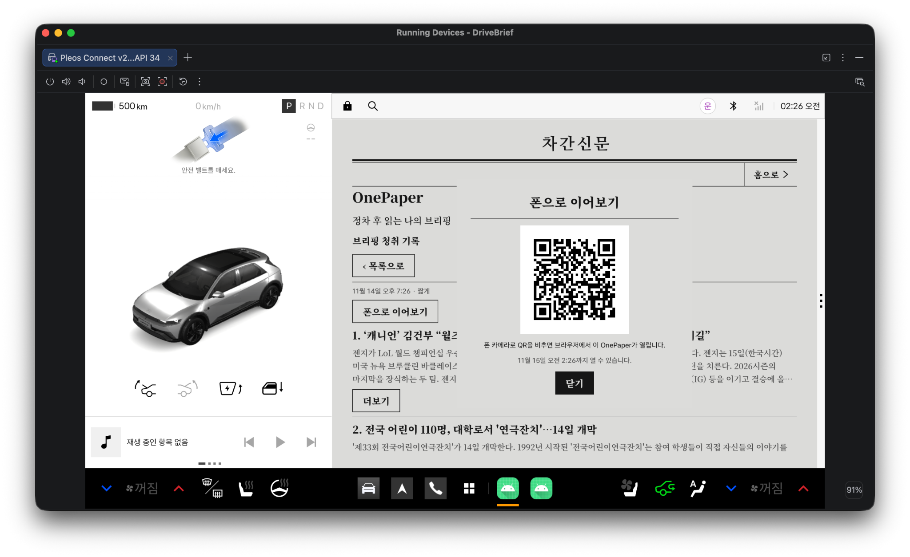
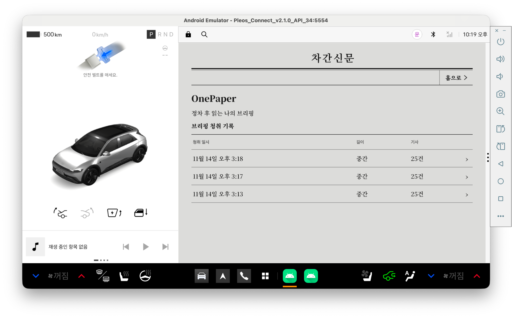
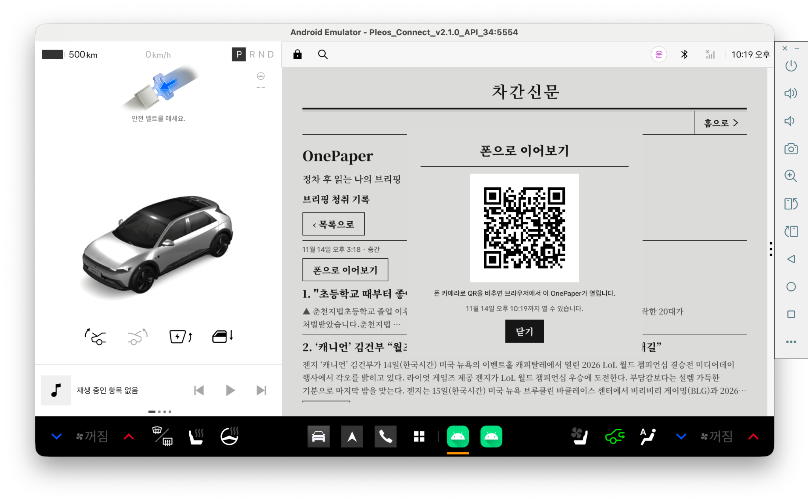
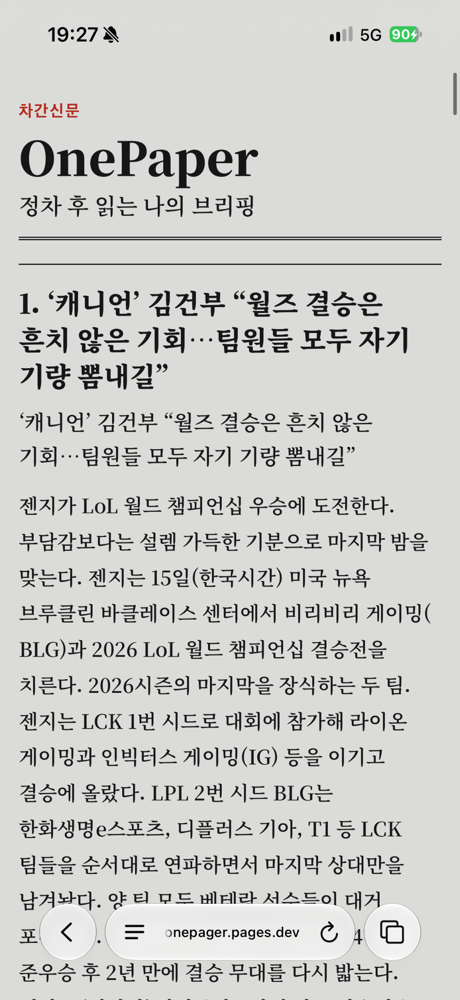
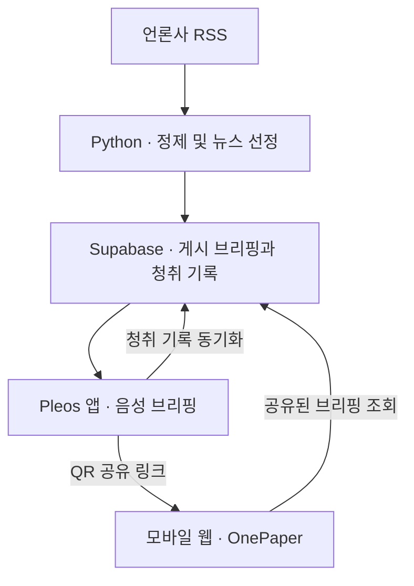

<div align="center">

# 차간신문

### 운전 중에는 듣고, 정차 후에는 읽고, 폰으로 이어보세요.

관심 뉴스를 음성 브리핑으로 듣고,<br>
들었던 소식을 나만의 신문 **OnePaper**로 다시 만나는 차량용 뉴스 서비스


[서비스 소개](#왜-차간신문인가요) · [주요 기능](#주요-기능) · [서비스 화면](#서비스-화면) · [개발 안내](#개발-안내)



**차 안에서 시작한 뉴스 경험을 차 밖까지.**

</div>

---

## 왜 차간신문인가요?

출근길에 궁금한 소식이 있어도 운전 중에는 기사를 읽기 어렵습니다. 라디오에서는 내가 관심 있는 분야만 골라 듣기 어렵고, 흘려들은 뉴스를 나중에 다시 찾기도 번거롭습니다.

차간신문은 **관심 분야 선택 → 음성으로 듣기 → 청취 기록 확인 → 휴대폰으로 이어보기**를 하나의 흐름으로 연결합니다. 차량에서는 듣기에 집중하고, 정차 후에는 신문을 펼치듯 뉴스를 다시 확인하는 경험을 만듭니다.

| 운전 전 | 운전 중 | 정차 후 | 차에서 내린 뒤 |
| :---: | :---: | :---: | :---: |
| 관심 분야와 설명량 선택 | Pleos TTS로 뉴스 청취 | OnePaper에서 기록 확인 | QR로 모바일 웹 이어보기 |

## 주요 기능

### 01. 관심 있는 소식부터, 필요한 만큼

경제·사회·정치·IT·스포츠 중 관심 분야를 선택합니다. 수집된 기사에서 중복과 동일 사건을 정리하고, 중요도와 분야 균형을 고려해 브리핑 후보를 선정합니다.

설명량은 **짧게 · 중간 · 길게**로 조절합니다. 같은 기사 묶음을 기준으로 제공하는 정보의 양을 바꾸며, RSS에 정보가 부족하면 문장을 억지로 늘리지 않습니다.

| 옵션 | 현재 RSS 브리핑의 구성 |
| --- | --- |
| 짧게 | 기사 설명의 완결된 첫 문장을 우선 사용하고, 부족하면 제목 사용 |
| 중간 | 제목과 설명을 합쳐 기사당 최대 3구간 |
| 길게 | 제목과 설명을 합쳐 기사당 최대 5구간 |

### 02. 화면보다 목소리로 만나는 뉴스

Pleos의 한국어 온디바이스 TTS로 브리핑을 재생합니다. 일시정지·재개·이전 및 다음 기사 이동을 지원하고, 오디오 포커스 변화를 처리합니다. 재생 위치를 기록해 브리핑을 이어 들을 수 있습니다.

### 03. 들었던 뉴스가 나만의 신문으로

**OnePaper**는 브리핑 청취 기록을 모아 보여주는 화면입니다. 이용 기록을 선택하면 해당 브리핑의 기사와 내용을 다시 확인할 수 있습니다. 신문의 제목·본문·구분선을 활용한 디자인으로 차량 화면과 모바일 웹의 경험을 연결합니다.

### 04. QR 한 번으로 휴대폰에서 이어보기

정차 상태에서 OnePaper의 **폰으로 이어보기**를 선택하면 QR 코드가 나타납니다. 휴대폰 카메라로 스캔하면 별도 앱 설치 없이 브라우저에서 해당 OnePaper를 열 수 있습니다. 공유 링크에는 유효기간이 적용됩니다.

## 서비스 화면

### 청취 기록을 한눈에

브리핑을 들었던 시점과 설명량, 기사 수를 확인하고 원하는 기록을 다시 엽니다.



### 차량에서 휴대폰으로

<table>
  <tr>
    <th width="70%">차량 · QR로 이어보기</th>
    <th width="30%">모바일 · OnePaper</th>
  </tr>
  <tr>
    <td valign="top"></td>
    <td valign="top" align="center"></td>
  </tr>
  <tr>
    <td>차량에서 선택한 브리핑을 QR 링크로 전달합니다.</td>
    <td>차량에서 들었던 뉴스를 휴대폰에서 다시 읽습니다.</td>
  </tr>
</table>

<sub>이미지는 Pleos 에뮬레이터와 모바일 브라우저에서 촬영한 개발 화면입니다. 화면의 기사와 구성은 촬영 당시 데이터입니다.</sub>

## 뉴스가 브리핑이 되기까지



| 단계 | 처리 내용 |
| --- | --- |
| 수집 | SBS·전자신문·경향신문·뉴시스·한국경제·매일경제·국민일보 RSS 수집 |
| 정제 | HTML·편집용 표식·기자명 등 낭독에 불필요한 요소 정리, 클로징과 불완전한 설명 필터링 |
| 선정 | URL·제목 중복 제거, 사건 그룹화, 중요도와 분야 균형을 고려해 최대 25건 선정 |
| 전달 | Supabase에 게시한 브리핑을 앱에서 조회하고 관심 분야에 맞춰 재생 |
| 기록 | 청취 기록을 저장하고 OnePaper와 QR 공유로 다시 제공 |

수집 프로세스는 시작 시 뉴스를 가져오고 실행 중에는 5분 간격으로 갱신합니다. **새 뉴스 수집에는 Mac 또는 서버의 수집 프로세스가 실행 중이어야 합니다.** 이미 게시된 뉴스는 공유 DB에서 조회합니다.

### AI 요약 개발 방향

현재 기본 브리핑은 **RSS 제목·설명을 정제하고 추출하는 방식**입니다. 별도의 AI 요약 경로에서는 Groq LLM, 원문 구간별 Evidence ID 연결, 숫자·부정 표현·확정성·행위자 관계 검증을 개발하고 있습니다. 생성 결과는 기존 사람 검토·승인 절차를 거칩니다.

기사 전문 기반 AI 요약을 기본 서비스에 연결하는 작업과 목표 청취시간에 맞춘 편성은 별도 개발·검증 범위입니다.

## 기술 구성

| 영역 | 사용 기술 |
| --- | --- |
| 차량 앱 | Kotlin · Jetpack Compose · Android Automotive OS |
| 차량 연동 및 음성 | Pleos SDK · On-device TTS · Audio Focus |
| 백엔드 | Python · FastAPI · Pydantic · SQLite |
| 공유 데이터 | Supabase · PostgreSQL · Auth · RPC |
| AI 요약 모듈 | Groq LLM · Evidence ID 기반 검증 · 사람 검토 |
| 모바일 연동 | OnePaper 웹 · QR 공유 링크 |

## 개발 안내

### 제출 APK

| 항목 | 내용 |
| --- | --- |
| 파일 위치 | [`apk/5HIFT_DriveBrief_release.apk`](apk/5HIFT_DriveBrief_release.apk) |
| 빌드 종류 | release · 버전 1.0.0 |

에뮬레이터 또는 차량 환경에 설치:

```bash
adb install -r apk/5HIFT_DriveBrief_release.apk
```

### 저장소 받기

```bash
git clone https://github.com/5HIFT-HMG/DriveBrief.git
cd DriveBrief
```

### 뉴스 수집 및 로컬 API

기존 팀 Supabase 프로젝트의 접속 설정을 `news_crawler/.env`에 넣습니다. 필요한 변수 이름은 [환경설정 예시](news_crawler/.env.example)를 참고하세요. 서버용 키는 로컬 설정에만 저장하고 Git에 포함하지 않습니다.

macOS에서는 저장소 루트에서 실행합니다.

```bash
./run-local.command
```

API는 `http://127.0.0.1:8000`에서 실행됩니다. 수집 상태는 `/v1/news/status`에서 확인합니다.

### Android 앱

Android Studio에서 저장소를 열고 Pleos 개발 환경을 구성한 뒤 앱을 실행합니다. 환경 준비는 [개발 환경 안내](setting.md), 기본 RSS 흐름은 [RSS 자동 브리핑 문서](backend/RSS_AUTO.md)를 참고하세요.

디버그 APK 빌드:

```bash
./gradlew :app:assembleDebug
```

생성 위치: `app/build/outputs/apk/debug/app-debug.apk`

### 관련 문서

| 문서 | 내용 |
| --- | --- |
| [개발 환경](setting.md) | Android 및 Pleos 환경 설정 |
| [RSS 자동 브리핑](backend/RSS_AUTO.md) | 현재 기본 서비스 흐름·실행·검증 범위 |
| [백엔드](backend/README.md) | Python 모듈과 개발 안내 |
| [Supabase 연결](supabase/README.md) | 공유 DB 설정 |
| [파이프라인 DB 통합](supabase/PIPELINE_INTEGRATION.md) | 데이터 연동 규격 |

---

<div align="center">

**차간신문**<br>
운전 중 흘려들은 소식이, 정차 후 읽을 나만의 신문이 되도록.

</div>
